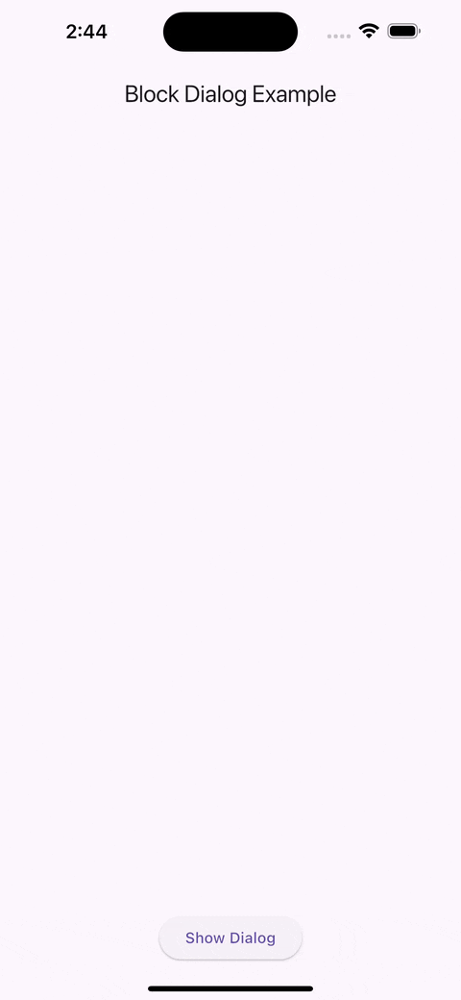
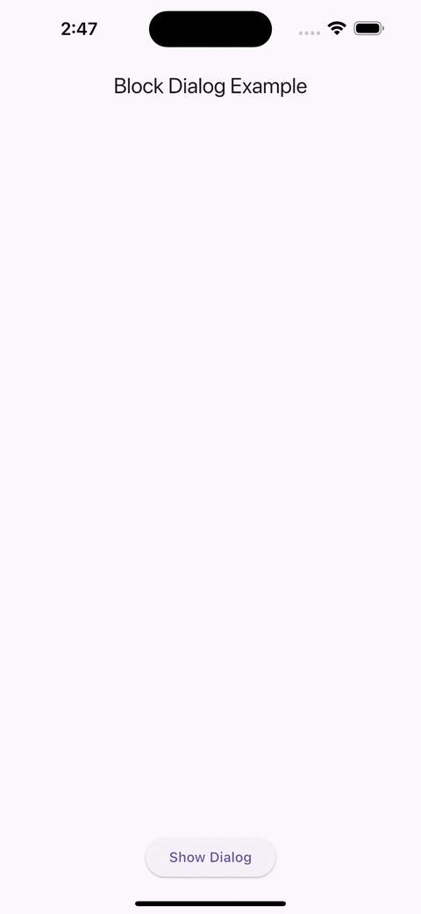

# block_dialog

Block-based, animated dialogs for Flutter with composable layout, typed results, full interaction among blocks, and fine-grained dismissal control.

## Features

- Compose dialogs from rows of blocks (text, buttons, inputs, radio group, checkbox, spacer, custom).
- Typed results with `BlocksResult<T>` and per-block `blockTag` keys.
- Multiple built-in block animations with easy customization.
- Animated dimmed background synchronized with dialog animation.
- Per-block overrides for position and animation.

## Install

Add to `pubspec.yaml`:

```yaml
dependencies:
  block_dialog: ^3.1.0
```

## Preview

| Slide                                      | Scale                                      | Cinematic                                      |
| ------------------------------------------ | ------------------------------------------ | ---------------------------------------------- |
|  |  |  |

---

## Quick Start

```dart
BlockDialog.show(
  context,
  rows: [
    BlockRow(blocks: [
      BlockText('Create account?', isDialogTitle: true),
    ]),
    BlockRow(blocks: [
      BlockTextField(blockTag: 'email', hintText: 'Email'),
    ]),
    BlockRow(blocks: [
      BlockTextField(blockTag: 'password', hintText: 'Password'),
    ]),
    BlockRow(blocks: [
      BlockButton(
        label: 'Continue',
        onPressed: (results, dialogController) {
          final email = results.getValue<String>(blockTag: 'email');
        },
      ),
      BlockButton(
        label: 'Cancel',
      ),
    ]),
  ],
);
```

## Blocks

- `BlockText` — simple text/title block.
- `BlockTextField` — text input.
- `BlockCheckbox` — boolean input.
- `BlockRadioGroup<T>` — single-choice selection.
- `BlockButton` — action button (optionally closes the dialog).
- `BlockSpacer` — vertical gap.
- `BlockCustom` — any widget, optionally with its own `BlockCustomController`.

## Blocks interaction through the `DialogController`

- `Block`
  - shakeBlock
- `BlockText`
  - setBlockText
- `BlockButton`
  - setBlockButtonLabel
  - setBlockButtonEnabled
  - performButtonTap
- `BlockCheckbox`
  - setBlockCheckboxValue
  - toggleBlockCheckboxValue
  - setBlockCheckboxEnabled
- `BlockRadioGroup<T>`
  - setBlockRadioGroupValue
  - setBlockRadioGroupOptionEnabled
- `BlockTextField`
  - setBlockTextFieldText
  - appendBlockTextFieldText
  - setBlockTextFieldErrorText
  - setBlockTextFieldEnabled
  - setBlockTextFieldReadOnly
  - clearBlockTextField
  - focusBlockTextField
  - unfocusBlockTextField
- `BlockCustom`
  - getBlockCustomController

## Styling & Config

```dart
const DialogConfig(
  backgroundColor: Color(0xFFF8FAFC),
  backgroundColorPressed: Color(0xFFE2E8F0),
  strokeColor: Color(0xFFCBD5E1),
  strokeWidth: 1,
  borderRadius: 20,
  blocksSpacing: 6,
  barrierColor: Color(0xB3000000),
  animationDuration: Duration(milliseconds: 420),
  blockAnimation: BlockAnimation.cinematic(),
  textStyle: TextStyle(fontSize: 16, color: Colors.black87),
)
```

## Animations

- `BlockAnimation.slide()`
- `BlockAnimation.scale`
- `BlockAnimation.elastic`
- `BlockAnimation.depth`
- `BlockAnimation.cinematic()`
- `BlockAnimation.expandFromCorner()`

## Results & Dismissal

- Each block that produces a value must provide a unique `blockTag`.
- `BlocksResult.dismissReason` indicates how the dialog closed.
- Tapping outside can be enabled/disabled with `barrierDismissible`.

## Custom Blocks

```dart
BlockCustom(
  blockTag: 'rating',
  blockController: BlockCustomController(),
  builder: (context, dialogController, controller, configs) {
    return const Center(child: Text('Custom'));
  },
)
```

## Frozen Rows (Non-scrollable rows)

Use `freeze` on `BlockRow` to control if it stays outside the scrollable section.

- `freeze: true` → always frozen.
- `freeze: false` → never frozen.
- `freeze: null` (default) → automatic behavior:
  - first row is frozen when it contains a single `BlockText` with `isDialogTitle: true`
  - last row is frozen when it contains only `BlockButton` blocks

- Frozen rows are allowed only at the beginning and/or the end of `rows`.
- Frozen rows in the middle are invalid.

Automatic freeze example (`freeze` omitted):

```dart
BlockDialog.show(
  context,
  rows: [
    BlockRow(blocks: [BlockText('Create account', isDialogTitle: true)]), // auto-frozen
    BlockRow(blocks: [BlockTextField(blockTag: 'email')]), // scrollable
    BlockRow(
      blocks: [BlockButton(label: 'Cancel'), BlockButton(label: 'Continue')], // auto-frozen
    ),
  ],
);
```

```dart
BlockDialog.show(
  context,
  rows: [
    BlockRow(
      freeze: true,
      blocks: [BlockText('Header', isDialogTitle: true)],
    ),
    BlockRow(blocks: [BlockText('Scrollable content')]),
    BlockRow(blocks: [BlockTextField(blockTag: 'email')]),
    BlockRow(
      freeze: true,
      blocks: [BlockButton(label: 'Done')],
    ),
  ],
);
```

Disable automatic freeze:

```dart
BlockRow(
  freeze: false,
  blocks: [BlockText('Title', isDialogTitle: true)],
)
```

## BlockRow.copyWith

```dart
final footerRow = BlockRow(
  blocks: [BlockButton(label: 'Cancel')],
);

final positiveFooterRow = footerRow.copyWith(
  blocks: [BlockButton(label: 'Continue', isPositive: true)],
  freeze: true,
);
```

## Example Project

See the `example/` folder for a full working demo.

---

## Additional Information

- **GitHub:** [https://github.com/tripletroop/flutter_block_dialog](https://github.com/tripletroop/flutter_block_dialog)
- **Pub.dev:** [https://pub.dev/packages/block_dialog](https://pub.dev/packages/block_dialog)

### Contributing

1. Fork the repository
2. Create a feature branch
3. Submit a pull request
4. Include tests for new features

### Issues

- File issues on GitHub
- Include Flutter/Dart version and error details
- Expect response within 1–3 business days

---

## License

MIT License. See [LICENSE](LICENSE) file.
